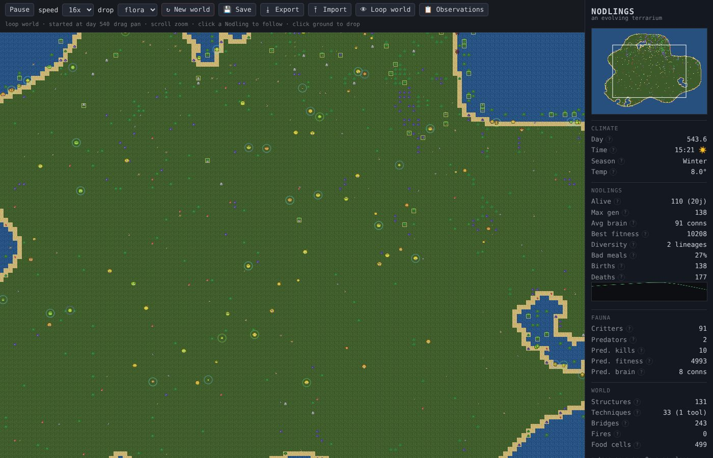
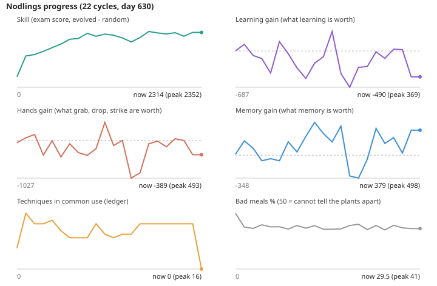

# Nodlings

**A small world where creatures with evolving brains live, breed and die, and an autonomous research
loop that tries to make them smarter.** Nobody scripts what a Nodling does. Its brain is a neural network
that evolves over generations and can learn during a lifetime. The project asks one question: can real
intelligence grow here, and can we prove it?

[](https://stijndh88.github.io/nodlings/)

**[Watch the live world](https://stijndh88.github.io/nodlings/)** · **[Progress dashboard](loop/dashboard.md)** · **[Roadmap](ROADMAP.md)** · **[Changelog](loop/CHANGELOG.md)**

## Where it stands



| | November 2026 | What it means |
|---|---|---|
| World age | day 2054, generation 4320 | One continuous world, running since October 2026 |
| **Skill** | 1000 to 1800 | Evolved Nodlings outscore random brains 4x to 7x on a fixed exam. It swings from cycle to cycle, so read the trend |
| **Memory gain** | +50 to +1400 | Blanking memory usually costs them a lot, but not in every reading |
| **Learning gain** | below zero | Learning during a lifetime does not help them yet. The first proven fix lands in mid November |

The honest summary: evolution taught the Nodlings to forage, breed and remember where things are, and then
it stalled, because the world became too easy to select for anything more. The [roadmap](ROADMAP.md) explains
why (with measurements) and what happens next: switch selection back on, make learning pay, then memory,
planning and cooperation.

## How it works

**The creature.** A Nodling has energy, water and body temperature to manage. Its brain maps 49 senses
(what is near, how it feels, what it remembers, what it hears, what its neighbour is doing) to 9 outputs
(move, grab, drop, eat or drink, strike, call, and two memory cells). Brains grow new neurons and
connections by mutation (NEAT style), and some connections change during life according to reward.

**The world.** A 200 x 150 continent ringed by ocean, with lakes, seasons, day and night, plants that
regrow, wildlife to hunt, predators with their own evolving brains, fire that cooks meat and fires clay
into brick, and water that can only be crossed by laying a bridge. Everything works through physical
properties of materials, never through a crafting menu.

**The research loop.** Every 4 hours an autonomous Claude routine advances the world, measures the
Nodlings and tests one idea for making them smarter:

1. **The exam.** A sample of living Nodlings is copied into fresh test worlds and scored on survival and
   offspring in three tasks: a normal world, a world with little food, and a world where thirst bites. The
   exam never changes, so the score is comparable over months. Switching one faculty off (learning, memory)
   and re-running the exam shows what that faculty is actually worth.
2. **Experiments.** A candidate change is stored as a patch. GitHub Actions evolves five copies of the world
   with the change and five without for about 40 generations, then compares exam scores with a t-test.
3. **Only proven changes land.** A change reaches the live world only when the Nodlings that evolved with it
   score measurably higher. Two runs of identical rules can differ by 5 to 55%, so a single before/after
   comparison is never trusted.

## Run it yourself

No build and no dependencies.

```bash
# watch: open index.html in a browser (or serve the folder and press "Loop world")
python3 -m http.server 8000

# measure the current gene pool on the exam, without touching the saved world
node loop/run-headless.js --dry --bench --ticks=0

# how noisy is the world? identical code, different random streams
node loop/ab.js --aa --ticks=6000 --replicates=3

# test an uncommitted change against HEAD on the current gene pool (about 4 minutes)
node loop/ab.js --instant --target=probes.evolved

# CI gate: self-test, resume, determinism
node loop/ci-check.js
```

In the browser: drag to pan, scroll to zoom, click a Nodling to follow it, click the ground to drop the
selected material. Every sidebar number has a `?` that explains it, and the Observations button opens the
log of an automated observer that records milestones and problems once per in-world day.

## Map of the repository

| Path | What it is |
|---|---|
| `brain.js` | Evolving neural network, learning rule, and `ENV`, the world's difficulty settings |
| `nodling.js` | The creature: needs, senses, actions, reproduction |
| `world.js` | Terrain, materials, climate, plants, fire |
| `critters.js`, `predators.js` | Wildlife, and predators with their own evolving brains |
| `sim.js` | The tick loop and saving or resuming a whole world |
| `metrics.js` | Progress metrics and the skill probes (the exam) |
| `index.html`, `main.js`, `render.js`, `sprites.js`, `observer.js` | The browser view |
| `docs/world-notes.md` | Longer notes on the world's mechanics |
| `ROADMAP.md` | The plan: findings, principles, phases with gates, hypothesis queues |
| `loop/RULES.md`, `loop/ROUTINE_PROMPT.md` | What the autonomous loop must do each cycle |
| `loop/PLAYBOOK.md` | Why the plan is what it is, how to design and read experiments, pitfalls, what to do when stuck |
| `loop/run-headless.js` | Advance the saved world and measure it |
| `loop/ab.js` | Replicated paired A/B test with a noise-aware verdict |
| `loop/experiments.js`, `loop/experiments/` | Long evolution experiments that run on GitHub Actions |
| `loop/world.json.gz`, `loop/history.jsonl` | The saved world and its measured history |
| `loop/dashboard.md`, `loop/dashboard.html`, `loop/progress.svg` | Progress pages, rebuilt every cycle |

## Design rules

- **No scripted behaviour.** New abilities must come from physics the brain can discover, not from recipes.
  The older reward bonuses that nudge building are being removed (roadmap phase 4).
- **Pressure before machinery.** A smarter brain only spreads when it means more offspring.
- **The exam is fixed; the world is not.** The world gets harder through `ENV`; the exam keeps its own settings.
- **No verdict without replicates.** No measurable effect means the change is not kept.
