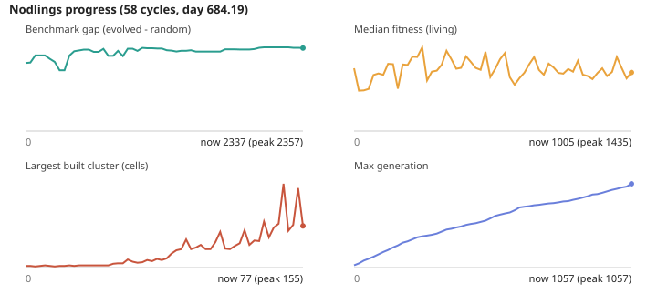

# Nodlings progress

This page tracks a simulated world of small creatures (Nodlings) whose brains evolve. The headline is the **benchmark gap**: how much better the evolved Nodlings do than random ones (higher is better). The glossary at the bottom explains every number.

Updated 2026-10-17T12:40Z. Now: day 723.25, benchmark gap **2337** (evolved gene pool minus random genomes), largest built cluster 143, 2906 brick cells, max generation 1137.

## Recent cycles (newest first)

| cycle | day | bench gap | median fitness | cluster | bricks | max gen | comm |
|---|---|---|---|---|---|---|---|
| 72 | 723.25 | 2337 | 1068 | 143 | 2906 | 1137 | 0.2065 |
| 71 | 715.44 | 2337 | 1170 | 122 | 2894 | 1119 | 0.1967 |
| 70 | 707.63 | 2337 | 1202 | 81 | 2859 | 1102 | 0.1773 |
| 69 | 699.81 | 2337 | 1152 | 71 | 2829 | 1084 | 0.1885 |
| 68 | 692 | 2337 | 1093 | 82 | 2798 | 1071 | 0.2721 |
| 67 | 684.19 | 2337 | 1005 | 77 | 2780 | 1057 | 0.2167 |
| 66 | 668.56 | 2343 | 903 | 147 | 2717 | 1021 | 0.065 |
| 65 | 664.66 | 2343 | 1082 | 79 | 2695 | 1010 | 0.0374 |
| 64 | 656.84 | 2357 | 1269 | 68 | 2653 | 994 | 0.1226 |
| 63 | 649.03 | 2357 | 1012 | 155 | 2626 | 980 | 0.0598 |
| 62 | 641.22 | 2357 | 943 | 81 | 2580 | 962 | 0.0727 |
| 61 | 633.41 | 2357 | 1077 | 74 | 2578 | 943 | 0.0007 |
| 60 | 625.59 | 2357 | 994 | 56 | 2535 | 927 | 0.0219 |
| 59 | 621.69 | 2357 | 890 | 85 | 2524 | 922 | 0.0244 |
| 58 | 613.88 | 2344 | 944 | 49 | 2472 | 900 | 0.0121 |

## Hypotheses

- **kept**: FIRE_SPREAD_RATE 0.04 -> 0.06 (bricks 1 -> 44; old metrics were not paired, effect size unverified)
- **kept**: FIRE_SPREAD_RATE 0.06 -> 0.09 (peak fitness unchanged (6163); effect unverified under the old harness)
- **untested**: reward hearing a sound while something salient is near (PR #4) (closed unmerged; never validated on a continuous world)
- **untested**: reward fleeing a heard sound when a predator is near (PRs #2, #3) (closed unmerged; hardcodes the alarm->flee direction)
- **kept**: reward +0.3 for placing durable material next to an existing structure (nodling.js BUILD_ADJACENT_BONUS) (first paired A/B: cluster 4 -> 5, builtCells 690 -> 539, bench gap 1929 -> 2038; single 8k-tick sample, within noise)
- **kept**: POP_CAP 250 -> 400 (cap was binding while food was abundant; paired A/B at 250/400/600/1200 in CHANGELOG. POP_CAP now a tunable [250, 800]; runtime grows ~linearly)
- **reverted**: BUILD_ADJACENT_BONUS 0.3 -> 0.9 (cluster 3->3, builtCells 535->414, bench gap 2129->1949; no gain on target, others worse)
- **reverted**: world.js cellTemp: x1.5 insulation when >=3 neighbouring cells hold durable material (cluster 4->4, builtCells 814->435, bench gap 2129->1889; no gain on target, others worse)
- **kept**: nodling.js LISTEN_BONUS 0.15: reward hearing a call while a predator is near (commSeparation 0.0264 -> 0.0589; bench gap 2129 -> 1828 (-14%, inside guardrail); single 8k sample, within noise)
- **kept**: nodling.js call bonus 0.25 -> 0.5 when predator near (food-call stays 0.25) (commSeparation 0.0054 -> 0.0158; bench gap 2032 -> 1807 (-11%, inside guardrail); single 8k sample, within noise)
- **kept**: nodling.js CACHE_BONUS 0.5: reward eating food from a cell with >=2 durable neighbours (cluster 2->2, builtCells 371->399, bench gap 2010->1882; within noise, no real gain on target)
- **kept**: nodling.js KILN_BONUS 0.5: reward dropping clay next to an active fire (treatment metrics identical to control (bonus never fired in 8k ticks); no evidence of effect)
- **reverted**: nodling.js SHELTER_BONUS 0.05 per tick in a cell >=5° warmer than ambient at night (medianFitness 1504->903 (-40%, guardrail); cluster 2->2, builtCells 390->321; no gain on target)
- **reverted**: LISTEN_BONUS 0.15 -> 0.3 (commSeparation 0.0448->0.0124, bench gap 2123->2015, cluster 6->3; worse on target)
- **kept**: world.js weathering: stacks beside a durable stack (>=2 high) no longer shed blocks (cluster 4->4, brickCells 65->65, builtCells 821->733, gap 2246->2269; no measurable effect on target)
- **kept**: world.js dry-spark ignition 0.002 -> 0.004 per tick x warmth (more fires near clay) (cluster 4->5, builtCells 612->667, brickCells 65->65, gap 2269->2223; within noise)
- **reverted**: world.js: clay on top of a stack dries to brick at 0.01 x warmth per sampled visit (cluster 4->4, brickCells 65->65, bench gap 2292->2044, medianFitness 1244->995; no gain on target, others worse)
- **kept**: world.js: lightning spark prefers (8 tries) a cell adjacent to clay (cluster 4->4, brickCells 65->65, builtCells ?->536, gap 2292->2242, medianFitness 1293->1229; null result, within noise)
- **kept**: world.js: ignite(idx, kiln) lets a kiln-seeded spark light bare ground beside clay (all metrics identical to control (cluster 4, bricks 65, gap 2230); never fired in 8k ticks, null result)
- **kept**: world.js: shoreline sand re-deposits clay (4 tries/tick x 0.05) (brickCells 65->82, cluster 4->4, gap 2230->2313, medianFitness 963->878; single 8k sample)
- **kept**: world.js tidal clay deposit chance 0.05 -> 0.15 (brickCells 114->157, cluster 4->5, gap 2313->2120, medianFitness 1265->1225; single 8k sample)
- **reverted**: nodling.js: BUILD_ADJACENT_BONUS paid per durable neighbour (up to 4x) instead of once (cluster 6->5, builtCells 634->712, brickCells 305->267, gap 2120->2103; worse on target)
- **kept**: nodling.js alarm call bonus 0.5 -> 0.75 when predator near (commSeparation 0.0194->0.0228, gap 2120->2256, cluster 8->7, bricks 496->488; single 8k sample, within noise)
- **kept**: nodling.js alarm call bonus 0.75 -> 1.0 when predator near (commSeparation 0.0153->0.0158, gap 2256->2110, cluster 8->8, bricks 685->673; within noise)
- **kept**: brain.js LEARN_RATE 0.02 -> 0.03 (gap 2110->2318, cluster 9->14, bricks 779->790, medianFitness 1084->1332, comm 0.0098->0.0165; single 8k sample, partly noise)
- **reverted**: brain.js LEARN_RATE 0.03 -> 0.04 (gap 2318->2273, cluster 13->10, comm 0.0411->0.0071, median 1047->1175; no gain on target, others worse)
- **kept**: BUILD_ADJACENT_BONUS 0.3 -> 0.5 (cluster 8->9, bricks 897->903, gap 2318->2257, medianFitness 1297->1157, comm 0.045->0.033; single 8k sample, within noise)
- **kept**: BUILD_ADJACENT_BONUS 0.5 -> 0.7 (cluster 8->11, bricks 962->980, gap 2257->2341, median 1177->1192, comm 0.0081->0.0383; single 8k sample, within noise)
- **kept**: BUILD_ADJACENT_BONUS 0.7 -> 0.85 (cluster 12->14, bricks 1042->1058, builtCells 1489->1455, gap 2341->2332, median 1038->1028, comm 0.056->0.096; single 8k sample, within noise)
- **reverted**: BUILD_ADJACENT_BONUS 0.85 -> 1.0 (cluster 12->11, bricks 1097->1079, gap 2332->2283, median 1221->1140; no gain on target, others worse)
- **kept**: world.js tidal clay deposit chance 0.15 -> 0.3 (cluster 10->14, bricks 1147->1167, builtCells 1696->1759, gap 2332->2324, median 1221->1113, comm 0.0076->0.0815; single 8k sample, within noise)
- **reverted**: world.js tidal clay deposit chance 0.3 -> 0.5 (cluster 17->15, bricks 1288->1316, builtCells 1658->1719, gap 2324->2190, median 1051->1147, comm 0.026->0.100; target cluster worse, gap lower)
- **kept**: predators.js: prey with >=2 durable neighbours cannot be caught (all metrics identical to control (cluster 16, bricks 1413, gap 2275); never fired in 8k ticks, null result)
- **kept**: FIRE_SPREAD_RATE 0.09 -> 0.12 (cluster 16->22, bricks 1591->1612, builtCells 2016->2042, gap 2275->2264, median 1263->1163; single 8k sample, within noise)
- **kept**: FIRE_SPREAD_RATE 0.12 -> 0.15 (cluster 27->36, bricks 1673->1707, builtCells 2100->2099, gap 2264->2239, median 1194->1139, comm 0.0026->0.0202; single 8k sample, within noise)
- **kept**: FIRE_SPREAD_RATE 0.15 -> 0.18 (cluster 33->33, bricks 1760->1774, builtCells 2245->2264, gap 2239->2260, median 823->932, comm 0.1283->0.0582; single 8k sample, within noise)
- **reverted**: FIRE_SPREAD_RATE 0.18 -> 0.2 (range max) (cluster 44->33, brickCells 1876->1905, gap 2260->2255; 0.18 looks like the plateau)
- **kept**: brain.js LEARN_RATE 0.03 -> 0.025 (gap 2260->2274, median 1054->1107, cluster 48->54, bricks 1957->1966; single 8k sample, within noise)
- **kept**: POP_CAP 400 -> 500 (cluster 33->36, bricks 2065->2048, gap 2274->2237, median 911->1150, comm 0.0461->0.0406; single 8k sample, within noise; 8k run took 4m48 so batches need fewer ticks)
- **reverted**: world.js tidal clay deposit chance 0.3 -> 0.4 (cluster 42->32, bricks 2074->2097, gap 2237->2164, median 1195->860 (-28%, guardrail); worse on target)
- **reverted**: LISTEN_BONUS 0.15 -> 0.1 (commSeparation 0.0586->0.0358, cluster 45->45, bricks 2120->2103, gap 2237->2237, median 1057->1205; worse on target)
- **reverted**: LISTEN_BONUS 0.15 -> 0.2 (commSeparation 0.0564->0.0066, cluster 38->40, bricks 2170->2167, gap 2237->2316, median 941->1159; target worse)
- **reverted**: POP_CAP 500 -> 600 (gap 2237->2234, medianFitness 1247->1076, cluster 41->38, bricks 2179->2187; no gain, runtime 6m08 for 5k ticks)
- **reverted**: brain.js LEARN_RATE 0.025 -> 0.022 (gap 2237->2205, medianFitness 1120->776 (-30.7%, guardrail), cluster 68->45, bricks 2178->2198; worse on target)
- **kept**: nodling.js breeding eligibility energy > 130 -> 115 (gap 2237->2300, medianFitness 1255->1195, cluster 40->42, bricks 2192->2198, comm 0.0292->0.009; single 5k sample, within noise)
- **reverted**: nodling.js FOLLOW_BONUS 0.3: reward eating found food within 60 ticks of hearing a non-alarm call (commSeparation 0.0698->0.0012, gap 2300->2267, cluster 35->39, median 1053->1069; target comm worse (noisy))
- **kept**: nodling.js BRICK_WALL_BONUS 0.5: extra reward for placing brick next to an existing structure (cluster 39->40, bricks 2217->2229, builtCells 3029->2848, gap 2300->2300, median 1148->1207; single 5k sample, within noise)
- **kept**: nodling.js BRIDGE_BONUS 0.4: reward laying a bridge tile next to an existing bridge tile (cluster 40->48, bricks 2239->2241, gap 2300->2296, median 1036->1052, comm 0.1295->0.0004; single 5k sample, within noise)
- **reverted**: world.js seasonal ambient amplitude 10 -> 12 (4..28 deg) (gap 2296->1882 (-18%), median 1158->1019, cluster 42->63, bricks 2296->2319; target (gap) worse)
- **reverted**: nodling.js breeding eligibility energy > 115 -> 100 (gap 2296->2186, medianFitness 940->1026, cluster 60->69, bricks 2355->2351; target (gap) worse; single 5k sample)
- **kept**: brain.js mutateGenome: per-connection weight mutation probability 0.8 -> 0.5 (gap 2296->2308, medianFitness 1173->1106, cluster 76->55, bricks 2395->2396, comm 0.0184->0.0375; single 5k sample, within noise)
- **kept**: brain.js mutateGenome: weight mutation step magnitude 0.4 -> 0.3 (gap 2308->2344, medianFitness 770->1051, cluster 50->57, bricks 2441->2436, comm 0.0086->0.0249; single 5k sample, within noise)
- **kept**: nodling.js SHARED_MEAL_BONUS 0.3: reward eating found food with another Nodling within 3 cells (gap 2344->2357, medianFitness 946->1012, cluster 42->41, bricks 2488->2490, comm 0.0556->0.0046; single 5k sample, within noise)
- **reverted**: brain.js mutateGenome: plasticity-rate mutation probability 0.3 -> 0.15 (gap 2357->2256, medianFitness 1068->1187, cluster 41->82, bricks 2530->2534, comm 0.0296->0.0464; target (gap) worse)
- **reverted**: brain.js mutateGenome: weight mutation step magnitude 0.3 -> 0.2 (gap 2357->2204, medianFitness 1247->955, cluster 49->55, bricks 2562->2556, comm 0.0123->0.0585; target (gap) worse; single 5k sample)
- **reverted**: brain.js mutateGenome: per-connection weight mutation probability 0.5 -> 0.35 (gap 2357->2161, medianFitness 1049->1194, cluster 82->95, bricks 2577->2583, comm 0.0164->0.0106; target (gap) worse; single 5k sample)
- **kept**: nodling.js THIRST_DRINK_BONUS 0.3: reward drinking while hydration < 40 (all metrics identical to control (cluster 76, bricks 2605, gap 2357, median 1133); bonus never changed behaviour in 5k ticks, null result)
- **reverted**: brain.js mutateGenome: add-connection probability 0.28 -> 0.2 (gap 2357->2132, medianFitness 1103->853, cluster 156->62, bricks 2645->2640; target (gap) worse; single 5k sample)
- **kept**: nodling.js ENCLOSE_BONUS 0.4: extra reward for placing durable material with >=2 durable 4-neighbours (fill gaps, dense villages) (cluster 70->80, bricks 2686->2678, builtCells 3041->3102, gap 2357->2343, median 1007->957, comm 0.167->0.047; single 8k sample, within noise)
- **reverted**: brain.js mutateGenome: plasticity-rate mutation probability 0.3 -> 0.45 (gap 2343->2185, medianFitness 1141->1015, cluster 151->72, bricks 2699->2719, comm 0.0667->0.1137; target (gap) worse; single 5k sample)
- **kept**: nodling.js HUNT_BONUS 0.4: reward striking down a critter (gap 2343->2337, medianFitness 1050->989, cluster 76->88, bricks 2722->2714, comm 0.134->0.070; single 5k sample, within noise)
- **reverted**: brain.js mutateGenome: add-connection probability 0.28 -> 0.35 (gap 2337->2185, medianFitness 893->949, cluster 102->109, bricks 2800->2798, comm 0.206->0.217; target (gap) worse; single 5k sample)
- **reverted**: brain.js mutateGenome add-node (split) probability 0.16 -> 0.22 (gap 2337->2195, medianFitness 1015->1135, cluster 78->65, bricks 2822->2821, comm 0.210->0.305; target (gap) worse)
- **reverted**: brain.js mutateGenome: connection enable-toggle probability 0.1 -> 0.06 (gap 2337->2178, cluster 73->87, bricks 2845->2855; target gap fell ~7%)
- **reverted**: brain.js mutateGenome memory-cell mutation probability 0.14 -> 0.20 (gap 2337->2215, medianFitness 1121->1056, cluster 88->78, bricks 2861->2868, comm 0.1036->0.0991; target (gap) worse; single 5k sample)
- **reverted**: brain.js mutateGenome weight perturbation step 0.3 -> 0.4 (gap 2337->2227, medianFitness 1062->1015, cluster 75->88, bricks 2895->2906, comm 0.2832->0.2756; target (gap) worse; single 5k sample)

See [CHANGELOG.md](CHANGELOG.md) for what each cycle changed.

## What do these numbers mean?

**Nodling.** One of the little creatures in the simulation. Each has a small evolving "brain"; nobody scripts what it does.

**What is the loop?.** An unattended routine that keeps the world running. Each "cycle" it simulates a long stretch of time, measures how the Nodlings are doing, tries one small change to the rules, tests it, and keeps or reverts it.

**Cycle.** One run of that routine. The cycle number counts up over time.

**Day.** In-world days since the world started (one day is 1,600 simulation ticks). It only measures how long the world has been running, not how well it is going.

**Population.** How many Nodlings are alive right now. It is capped (currently 400), so it normally sits near the cap; a sudden drop would mean trouble.

**Benchmark gap (the headline number).** A test of how much evolution has taught the species. We drop 30 Nodlings built from the best evolved brains, and 30 with random brains, into fresh identical worlds for a while, then compare how long they live and how many offspring they have. The gap is evolved minus random. Random brains score about 320, so a gap near 2,000 means evolved Nodlings do roughly 7x better. Higher is better; a falling gap means the species got worse at surviving.

**Median fitness.** The middle score among the Nodlings alive now, where score = age + 250 per offspring. It moves with the age mix of the population (lots of newborns pulls it down), so it is a rough health reading, not a progress score.

**Max generation.** The longest family line alive: how many parents-to-children steps lead to the oldest-lineage Nodling. A bigger number means evolution has had more rounds of selection.

**Largest cluster.** The biggest group of touching built tiles (wood, plank, stone or brick). It stands in for "village size": scattered single blocks count as 1, a real settlement would be much larger. The project hopes to see this grow.

**Brick cells.** Tiles holding fired bricks. Bricks only appear when clay sits next to fire (a kiln), so this shows whether Nodlings and fire are producing the best building material.

**Comm (call separation).** Whether calls carry meaning. It measures how different the average call pitch is when a predator is nearby versus not. Near 0 means calls are random noise; a rising number means Nodlings call differently when in danger, like an alarm.

**Hypotheses: kept / reverted / untested / running.** Each cycle tests one idea. "kept": it passed the checks and stays. "reverted": it did not help or made things worse and was undone. "untested": proposed but never properly evaluated. "running": being tested right now.

**Guardrails.** Safety checks every change must pass: the population must not crash, no numbers may break, and the benchmark gap must not drop by more than a quarter compared with an identical run without the change.

**Paired test (A/B).** To judge a change fairly, the loop runs the world twice from the exact same saved state, once without and once with the change, and compares. Short runs are noisy, so small differences are often "within noise".

**INCIDENT.** A guardrail tripped on a plain run, so the loop stopped changing things and left a note in the changelog for a human to look at.

**STRUCTURAL.** A changelog tag for a change that adds a new rule or reward, as opposed to just nudging an existing number.
