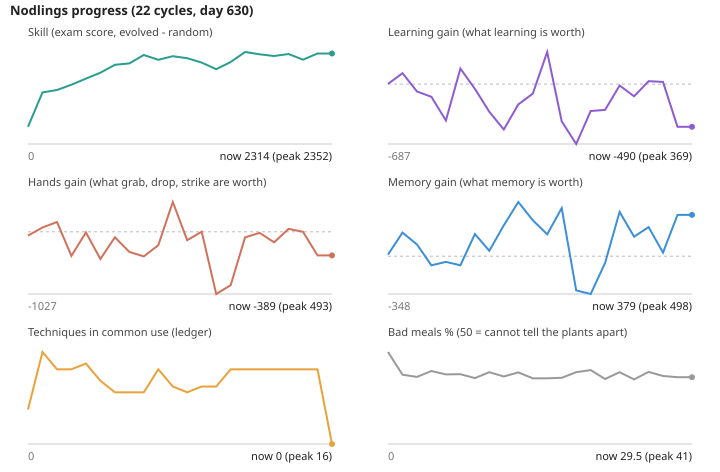

# Nodlings progress

This page tracks a simulated world of small creatures (Nodlings) whose brains evolve. The headline is **skill**: how much better the evolved Nodlings score on a fixed exam than Nodlings with random brains (higher is better). **Learning gain** and **memory gain** show whether they actually use learning and memory. The glossary at the bottom explains every number.

Updated 2026-11-14T00:31Z. Now: day 2072.78, skill **692**, learning gain 250, memory gain -3, brain size 118.2, max generation 4371. The plan is in [ROADMAP.md](../ROADMAP.md).

## Recent cycles (newest first)

| cycle | day | skill | learning gain | memory gain | brain | median fitness | max gen |
|---|---|---|---|---|---|---|---|
| 229 | 2072.78 | 692 | 250 | -3 | 118.2 | 1003 | 4371 |
| 228 | 2063.41 | 985 | -191 | 53 | 114 | 1023 | 4349 |
| 227 | 2054.03 |  |  |  | 107 | 1245 | 4320 |
| 226 | 2046.22 |  |  |  | 102.4 | 1071 | 4300 |
| 225 | 2038.41 |  |  |  | 94.4 | 1213 | 4279 |
| 224 | 2022.78 |  |  |  | 100.8 | 1040 | 4264 |
| 223 | 2014.97 |  |  |  | 113.6 | 1064 | 4245 |
| 222 | 2007.16 |  |  |  | 120 | 1257 | 4223 |
| 221 | 1999.34 |  |  |  | 121.9 | 1339 | 4207 |
| 220 | 1991.53 |  |  |  | 119.8 | 1346 | 4185 |
| 219 | 1983.72 |  |  |  | 119.9 | 1131 | 4170 |
| 218 | 1975.91 |  |  |  | 119.9 | 1228 | 4148 |
| 217 | 1968.09 |  |  |  | 122.7 | 1138 | 4135 |
| 216 | 1960.28 |  |  |  | 122.3 | 1172 | 4125 |
| 215 | 1952.47 |  |  |  | 126.1 | 1068 | 4105 |

## Latest hypotheses

- **running**: Learn from reward minus its running average (prediction error) instead of raw reward, which is almost always positive (ROADMAP phase 2.1). Instant screen: no immediate effect (learningGain -73 -> -81, t=-0.05), no guardrail (evolution experiment submitted at 82b15da)
- **running**: ENV.thirst 1 -> 3: a newborn's water lasts ~740 ticks instead of ~2200, so never drinking is fatal inside the breeding life (ROADMAP phase 1.1). Screen: population 499 after 6000 ticks, thirst deaths 3709 (evolution experiment submitted at 82b15da)
- **kept**: brain.js LEARN_RATE 0.028 -> 0.031 (bench gap 1212->1709, medianFitness 1225->987 (within guardrail); single 8k sample, likely partly noise)
- **kept**: brain.js LEARN_RATE 0.025 -> 0.028 (bench gap 2013->2061, medianFitness 903->1462; single 8k sample, likely partly noise)
- **reverted**: world.js per-year deterministic flora regrowth multiplier 0.8..1.15 (unpredictable good/lean years reward plasticity) (bench gap 1933 -> 1402 (-27.5%, guardrail fail))
- **reverted**: brain.js: 3% of connection weights resampled uniformly per mutation (heavy-tail jumps) (bench gap 1723 -> 1273 (guardrail fail), median 1126 -> 1053)
- **reverted**: STRUCTURAL: world.js a vertical 1/5-width band blocks flora regrowth, shifting every 8 days (stale food memory) (bench gap 1815->1758, medianFitness 1102->1076; target worse)
- **kept**: world.js: empty inland land cells beside a brick-topped cell slowly yield clay (15% per tidal-clay roll) (cluster 1087->1138, brickCells 3960->4014, bench gap 1980->1953 (noise); single 8k sample)
- **kept**: world.js tidal clay deposit fires straight to brick when beside a brick-topped cell (brickCells 3958->3959, cluster 1107->1107, bench gap 1933->1980; within noise)
- **reverted**: STRUCTURAL: nodling.js newborn +30 energy when parent inVillage (cluster 1107->1083, builtCells 4383->4307; target worse)
- **reverted**: STRUCTURAL: nodling.js breeding chance x1.3 while inVillage (largestCluster 1113 -> 1088, builtCells 4643 -> 4525 (worse); medianFitness 1190 -> 1253, gap 1933 unchanged)
- **kept**: STRUCTURAL: nodling.js CALL_BRICK_BONUS x2 while inVillage (metrics bit-identical to control; null result in this window)
- **kept**: STRUCTURAL: nodling.js BRICK_GRAB_BONUS x2 while inVillage (metrics bit-identical to control; null result in this window)
- **kept**: nodling.js CALL_BUILD_BONUS x2 while inVillage (metrics bit-identical to control; null result)
- **kept**: STRUCTURAL: nodling.js TEAM_BUILD_BONUS x2 while inVillage (metrics bit-identical to control; null result)
- **kept**: STRUCTURAL: nodling.js SHARED_MEAL_BONUS x2 while inVillage (commSeparation 0.0592 -> 0.0594, within noise; medianFitness 1143 -> 1506, gap 1933 unchanged)
- **reverted**: nodling.js CALL_FOLLOW_BONUS x2 while inVillage (commSeparation 0.0473->0.0400 (worse); cluster 1934->1955, bench gap 1933->1933)
- **kept**: STRUCTURAL: nodling.js KILN_BONUS x2 while inVillage (bit-identical to control; null result in 8k window)
- **kept**: STRUCTURAL: nodling.js HUNT_BONUS x2 while inVillage (largestCluster 1971 -> 1981, within noise but not worse; medianFitness 1427 -> 1103 (guardrail passes))
- **reverted**: STRUCTURAL: nodling.js fire death roll x0.5 while inVillage (largestCluster 1030 -> 1021, medianFitness 1227 -> 1182; not better)
- **kept**: STRUCTURAL: nodling.js ENCLOSE_BONUS x2 while inVillage (bit-identical to control (null result, no measurable effect in 8k window))
- **kept**: STRUCTURAL: nodling.js movement energy cost x0.5 while inVillage (largestCluster 1029 -> 1037, builtCells 4405 -> 4429; small, within noise but not worse)
- **kept**: nodling.js BRICK_TOWER_BONUS x2 while inVillage (bit-identical to control (null result, no measurable effect in 8k window))
- **reverted**: nodling.js: body temperature drift x0.5 while inVillage (largestCluster 1007 -> 999, within noise but not better)
- **reverted**: STRUCTURAL: nodling.js LISTEN_BONUS x2 while inVillage (commSeparation 0.0585->0.0244; target worse)

See [CHANGELOG.md](CHANGELOG.md) for what each cycle changed.

## What do these numbers mean?

**Nodling.** One of the little creatures in the simulation. Each has a small evolving "brain"; nobody scripts what it does.

**What is the loop?.** An unattended routine that keeps the world running. Each "cycle" it simulates a long stretch of time, measures how the Nodlings are doing, tries one small change to the rules, tests it, and keeps or reverts it.

**Cycle.** One run of that routine. The cycle number counts up over time.

**Day.** In-world days since the world started (one day is 1,600 simulation ticks). It only measures how long the world has been running, not how well it is going.

**Skill (the headline number).** An exam for the species. A sample of 40 living Nodlings is copied into fresh, identical test worlds and scored on how long each lives and how many offspring it has. There are three tasks: a normal world, a world with little food, and a world where thirst bites five times faster. The same exam is given to Nodlings with random brains. Skill is the evolved score minus the random score, averaged over the tasks. The exam never changes when the live world is made harder, so a rising line means the Nodlings really got better.

**Learning gain.** The exam score with learning switched on, minus the score of the same Nodlings with learning switched off. It answers "does learning during a lifetime actually help them?". Positive means it helps. At or below zero means the brains do not use learning yet, which is where the project started in November 2026.

**Memory gain.** The same idea for memory: the normal exam score minus the score when the memory senses (remembered food, water and shelter, plus the two memory cells) are blanked. A large positive number means the Nodlings rely on memory.

**Brain size.** Average number of connections in a living Nodling brain. Not a goal by itself, but a collapse suggests that thinking no longer pays.

**Median fitness.** The middle score of the Nodlings alive right now, where score = age in ticks + 250 per offspring. It swings as old Nodlings die, so read the trend, not one value.

**Max generation.** The longest family line alive: how many parent-to-child steps separate it from the first Nodlings.

**Old benchmark gap.** The headline until cycle 228. It let the test colony breed until it filled the map, so it mostly measured how fast a colony grows and it barely moved for a month. Replaced by Skill.

**Population.** How many Nodlings are alive right now. It is capped (currently 500), so it normally sits near the cap; a sudden drop would mean trouble.

**Instant test.** A quick check of a rule change: the same living Nodlings sit the exam under the old and the new rules, on several sets of test worlds. It shows the immediate effect of the change.

**Evolution experiment.** The real test of a change. Several copies of the world evolve for about 40 days with the change and several without it, on GitHub Actions. A change is kept only if the Nodlings that evolved with it score measurably higher on the exam. One run per side proves nothing: identical rules can differ by 5 to 55 percent between two runs.

**INCIDENT.** A guardrail tripped on a plain run, so the loop stopped changing things and left a note in the changelog for a human to look at.

**STRUCTURAL.** A changelog tag for a change that adds a new rule or reward, as opposed to just nudging an existing number.
